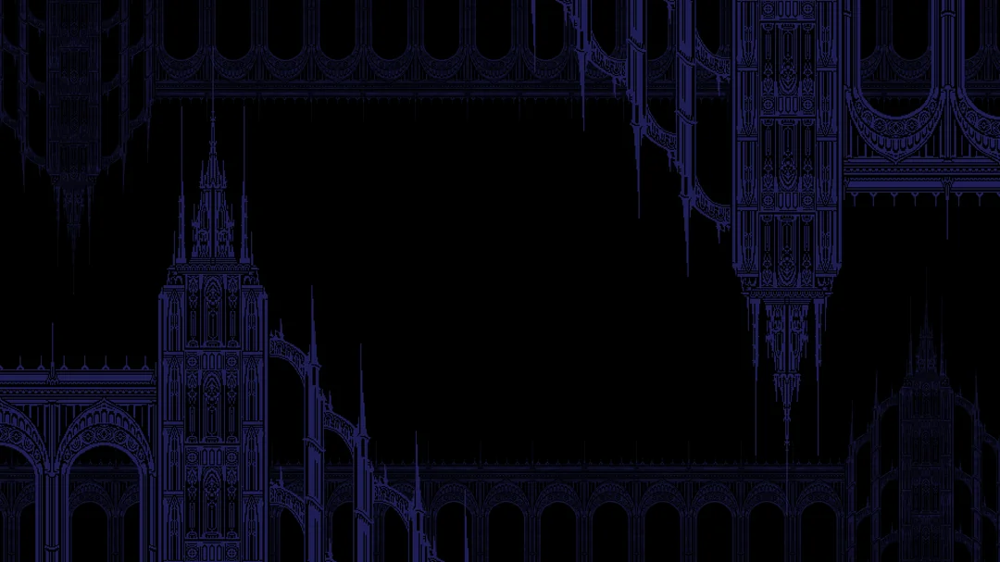

  

## yo

I’m a student dev, and I don't stick to anything specific.
### Experience
- Philadelphia Regional Media & Design Competition:
  - 2024: 2nd Place, Programming — Micro:bit + electromyography project
  - 2025: 1st Place Solo, Programming
  - 2026: 1st Place Team, Web Design — TutorMate AI
- PA State Media & Design Competition (2026): 2nd Place Team
- Ara (now Reason Machines) x Anthropic x UPenn Hackathon: Won “Most Technical” out of ~100 participants

### Robotics & Hardware
- FLL Team 9891: Helped program during the SUBMERGED and UNEARTHED seasons
- Hardware I’ve used: Micro:bit, LEGO Mindstorms EV3, Raspberry Pi Zero 2W, Arduino Uno R4 WiFi

### Skills
- Strong: HTML, CSS, block-based coding, project design
- Medium: Python, Git, GitHub
- Learning: JavaScript, Java, Kotlin, advanced web development, AI, Rust

### Tools & IDEs
- VS Code, PyCharm, Zed, Roblox Studio, Eclipse Animator
- AI tools: Codex, OpenCode, Ollama
